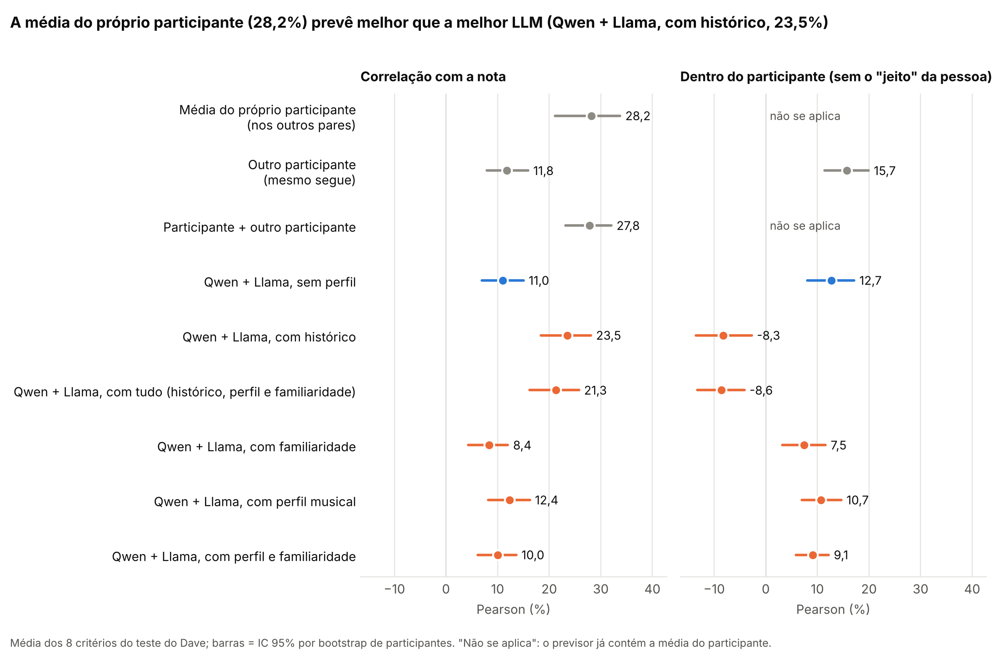
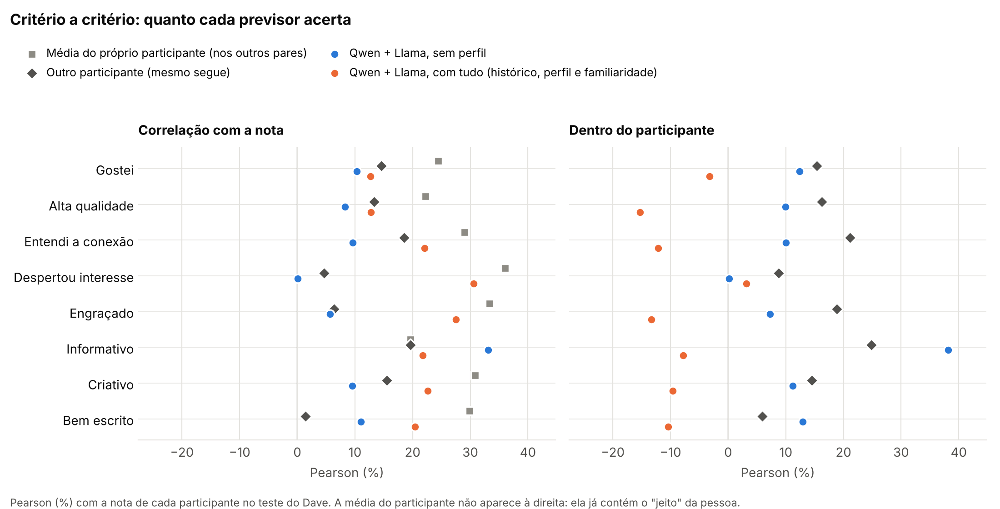

# Treino e teste no Dave: dave_local
150 participantes. Cada par avaliado vira teste uma vez; o treino são os outros pares do mesmo participante. Comparação em pelo menos 794 notas por métrica (segues vistos por 2+ participantes, sem falha de leitura).
- `pearson`: correlação com a nota do participante.
- `centrada`: correlação dentro do participante (a média de cada participante sai da nota real e da previsão): só a reação ao segue, sem o "jeito" da pessoa. A `media_usuario` sai negativa aqui por construção: ela não sabe nada sobre os segues.
- `dif_vs_media_usuario`: diferença de Pearson para a média do próprio participante; se o IC não inclui zero, a diferença é significativa a 5%.
- IC 95% por bootstrap de participantes.
Respostas que não puderam ser lidas: qwen2.5-7b__historico 0.0%, qwen2.5-7b__completo 0.0%, qwen2.5-7b__familiaridade 0.0%, qwen2.5-7b__perfil 0.0%, qwen2.5-7b__perfil_familiaridade 0.0%, llama3.1-8b__historico 0.1%, llama3.1-8b__completo 0.0%, llama3.1-8b__familiaridade 0.0%, llama3.1-8b__perfil 0.0%, llama3.1-8b__perfil_familiaridade 0.0%

## Média dos 8 critérios (%)

| previsor                               |   pearson_% |   ic_inf_% |   ic_sup_% |   centrada_% |   centrada_ic_inf_% |   centrada_ic_sup_% |   dif_vs_media_usuario_% |   dif_ic_inf_% |   dif_ic_sup_% |
|:---------------------------------------|------------:|-----------:|-----------:|-------------:|--------------------:|--------------------:|-------------------------:|---------------:|---------------:|
| media_usuario                          |        28.2 |       21.1 |       33.8 |        -60.8 |               -63.2 |               -58.2 |                      0   |            0   |            0   |
| outro_humano                           |        11.8 |        7.9 |       15.9 |         15.7 |                11.4 |                19.9 |                    -16.4 |          -23.5 |           -7.5 |
| usuario_mais_segue                     |        27.8 |       23.1 |       32.1 |         -7   |               -11.4 |                -2.3 |                     -0.4 |           -4.1 |            4.3 |
| qwen2.5-7b__E0                         |         8.4 |        5.1 |       11.3 |          9.9 |                 6.3 |                13.4 |                    -19.8 |          -26.9 |          -11.8 |
| llama3.1-8b__E0                        |         9.8 |        5.8 |       13.6 |         11.3 |                 6.8 |                15.6 |                    -18.4 |          -25.6 |          -10.2 |
| media-qwen-llama__E0                   |        11   |        6.9 |       15   |         12.7 |                 8.1 |                17.1 |                    -17.2 |          -24.5 |           -8.7 |
| qwen2.5-7b__historico                  |        19.7 |       13.8 |       24.8 |        -17.3 |               -21.9 |               -12.6 |                     -8.5 |          -12.1 |           -4.5 |
| llama3.1-8b__historico                 |        18.5 |       14.4 |       22.4 |          2.2 |                -3   |                 7   |                     -9.6 |          -15.8 |           -2.9 |
| media-qwen-llama__historico            |        23.5 |       18.4 |       28.1 |         -8.3 |               -13.6 |                -2.7 |                     -4.7 |           -9.2 |            0.4 |
| qwen2.5-7b__completo                   |        19.6 |       13.9 |       24.4 |        -16.6 |               -21   |               -11.8 |                     -8.6 |          -12.2 |           -5.1 |
| llama3.1-8b__completo                  |        16.4 |       12   |       20.7 |          1.3 |                -2.8 |                 5.4 |                    -11.7 |          -18.1 |           -5.3 |
| media-qwen-llama__completo             |        21.3 |       16.2 |       25.8 |         -8.6 |               -13.3 |                -4.1 |                     -6.9 |          -11.5 |           -2.3 |
| qwen2.5-7b__familiaridade              |         6.6 |        3.2 |        9.7 |          4.8 |                 1.8 |                 8   |                    -21.6 |          -27.5 |          -14.5 |
| llama3.1-8b__familiaridade             |         6.9 |        2.5 |       10.7 |          6.8 |                 2.3 |                11   |                    -21.3 |          -27.8 |          -13.7 |
| media-qwen-llama__familiaridade        |         8.4 |        4.3 |       12   |          7.5 |                 3.2 |                11.6 |                    -19.8 |          -26.2 |          -12.6 |
| qwen2.5-7b__perfil                     |         6.5 |        3.2 |        9.6 |          3.1 |                -0   |                 6.4 |                    -21.7 |          -27.8 |          -14.1 |
| llama3.1-8b__perfil                    |        12.1 |        8.2 |       15.8 |         11.5 |                 7.7 |                15.3 |                    -16.1 |          -22.9 |           -8.4 |
| media-qwen-llama__perfil               |        12.4 |        8.2 |       16.2 |         10.7 |                 7   |                14.7 |                    -15.8 |          -22.3 |           -8.3 |
| qwen2.5-7b__perfil_familiaridade       |         6.5 |        3.3 |        9.6 |          3.5 |                 0.7 |                 6.3 |                    -21.7 |          -27.7 |          -14.3 |
| llama3.1-8b__perfil_familiaridade      |        10.3 |        6.4 |       13.8 |         10.4 |                 7.1 |                13.6 |                    -17.9 |          -25   |           -9.9 |
| media-qwen-llama__perfil_familiaridade |        10   |        6.2 |       13.6 |          9.1 |                 5.8 |                12.2 |                    -18.2 |          -24.9 |          -10.4 |

## Pearson por critério (%)

| metrica          |   llama3.1-8b__E0 |   llama3.1-8b__completo |   llama3.1-8b__familiaridade |   llama3.1-8b__historico |   llama3.1-8b__perfil |   llama3.1-8b__perfil_familiaridade |   media-qwen-llama__E0 |   media-qwen-llama__completo |   media-qwen-llama__familiaridade |   media-qwen-llama__historico |   media-qwen-llama__perfil |   media-qwen-llama__perfil_familiaridade |   media_usuario |   outro_humano |   qwen2.5-7b__E0 |   qwen2.5-7b__completo |   qwen2.5-7b__familiaridade |   qwen2.5-7b__historico |   qwen2.5-7b__perfil |   qwen2.5-7b__perfil_familiaridade |   usuario_mais_segue |
|:-----------------|------------------:|------------------------:|-----------------------------:|-------------------------:|----------------------:|------------------------------------:|-----------------------:|-----------------------------:|----------------------------------:|------------------------------:|---------------------------:|-----------------------------------------:|----------------:|---------------:|-----------------:|-----------------------:|----------------------------:|------------------------:|---------------------:|-----------------------------------:|---------------------:|
| creative         |               8.3 |                    15.4 |                          4.8 |                     12.1 |                   8   |                                10.8 |                    9.6 |                         22.7 |                               7.1 |                          22.3 |                        7.9 |                                     15.6 |            30.8 |           15.5 |              7.2 |                   22.4 |                         8.3 |                    22.9 |                  1.1 |                               17   |                 30.6 |
| funny            |               0.2 |                    24   |                         -2.1 |                     24.6 |                   3   |                                 0.4 |                    5.7 |                         27.5 |                              -1.9 |                          25.7 |                        6.3 |                                     -3   |            33.4 |            6.4 |              8.5 |                   21.9 |                        -0.7 |                    19   |                  6.8 |                               -4   |                 28.7 |
| high_quality     |               7.9 |                    11.1 |                          6.2 |                     16.5 |                  17.7 |                                 9.8 |                    8.3 |                         12.8 |                               7.5 |                          17.2 |                       17.5 |                                      9.7 |            22.2 |           13.3 |              5.5 |                   10.5 |                         5.1 |                    11.1 |                  7.9 |                                6.5 |                 24.7 |
| informative      |              35.4 |                    21.9 |                          6.4 |                     25.8 |                   5.8 |                                 8.6 |                   33.1 |                         21.8 |                               7.1 |                          28.4 |                        6.1 |                                      4.3 |            19.7 |           19.6 |             19.1 |                   13.9 |                         3.5 |                    20.7 |                  1.9 |                               -3.7 |                 28.2 |
| likeable         |               9   |                     7.6 |                          5.9 |                     16.5 |                  13.6 |                                10.8 |                   10.3 |                         12.7 |                               9.6 |                          18.7 |                       14.1 |                                     11.7 |            24.5 |           14.6 |              8.8 |                   16.8 |                        10.6 |                    14   |                  9.3 |                               10.4 |                 26.9 |
| media_8          |               9.8 |                    16.4 |                          6.9 |                     18.5 |                  12.1 |                                10.3 |                   11   |                         21.3 |                               8.4 |                          23.5 |                       12.4 |                                     10   |            28.2 |           11.8 |              8.4 |                   19.6 |                         6.6 |                    19.7 |                  6.5 |                                6.5 |                 27.8 |
| sparked_interest |              -0.1 |                    21.3 |                         13   |                     20.7 |                  17.5 |                                17.4 |                    0   |                         30.6 |                              13.6 |                          29.6 |                       16.8 |                                     18.1 |            36.1 |            4.7 |              1.3 |                   29.7 |                         6.9 |                    26.6 |                  9.3 |                               12.2 |                 27.9 |
| understandable   |               6.4 |                    14   |                         17.1 |                     15   |                  18.8 |                                14.1 |                    9.6 |                         22.1 |                              17.4 |                          24   |                       16.3 |                                     14.5 |            29   |           18.5 |             13.3 |                   23.1 |                        11.5 |                    24.2 |                  6.1 |                               10.8 |                 33.6 |
| well_written     |              11.5 |                    16.2 |                          3.7 |                     17.2 |                  12.2 |                                10.6 |                   11   |                         20.4 |                               6.6 |                          22   |                       13.9 |                                      9.2 |            29.9 |            1.4 |              3.2 |                   18.2 |                         7.7 |                    19.1 |                  9.4 |                                3.1 |                 21.7 |

## Pearson com a nota centrada, por critério (%)

| metrica          |   llama3.1-8b__E0 |   llama3.1-8b__completo |   llama3.1-8b__familiaridade |   llama3.1-8b__historico |   llama3.1-8b__perfil |   llama3.1-8b__perfil_familiaridade |   media-qwen-llama__E0 |   media-qwen-llama__completo |   media-qwen-llama__familiaridade |   media-qwen-llama__historico |   media-qwen-llama__perfil |   media-qwen-llama__perfil_familiaridade |   media_usuario |   outro_humano |   qwen2.5-7b__E0 |   qwen2.5-7b__completo |   qwen2.5-7b__familiaridade |   qwen2.5-7b__historico |   qwen2.5-7b__perfil |   qwen2.5-7b__perfil_familiaridade |   usuario_mais_segue |
|:-----------------|------------------:|------------------------:|-----------------------------:|-------------------------:|----------------------:|------------------------------------:|-----------------------:|-----------------------------:|----------------------------------:|------------------------------:|---------------------------:|-----------------------------------------:|----------------:|---------------:|-----------------:|-----------------------:|----------------------------:|------------------------:|---------------------:|-----------------------------------:|---------------------:|
| creative         |               9.5 |                    -0.8 |                          3.5 |                     -1.2 |                   5   |                                 6.3 |                   11.2 |                         -9.6 |                               5.7 |                          -8.4 |                        5.3 |                                      9.8 |           -63.2 |           14.5 |              9.6 |                  -16.2 |                         7.8 |                   -12.3 |                  2.2 |                               11.1 |                 -8.9 |
| funny            |               0.9 |                     0   |                         -2.2 |                     -6.2 |                   1.4 |                                 1.7 |                    7.2 |                        -13.4 |                              -3.9 |                         -19   |                        4.1 |                                     -1.6 |           -63   |           18.9 |              9.8 |                  -22.1 |                        -4.2 |                   -23.5 |                  5.1 |                               -3.1 |                 -5.4 |
| high_quality     |               9.5 |                    -5.6 |                          8.9 |                      0.6 |                  15.7 |                                 8.8 |                    9.9 |                        -15.3 |                               7.4 |                         -10.3 |                       14.5 |                                      7.2 |           -58.7 |           16.2 |              6.6 |                  -20.3 |                        -0.6 |                   -19.6 |                  2.7 |                                1.2 |                 -5   |
| informative      |              40.8 |                     8.9 |                          6.3 |                      9.8 |                   7.1 |                                 9.7 |                   38.1 |                         -7.8 |                               6   |                          -2.2 |                        6.1 |                                      4.5 |           -61.7 |           24.8 |             21.6 |                  -21.2 |                         0.3 |                   -16.9 |                 -0.4 |                               -4.7 |                  1.5 |
| likeable         |              11.1 |                    -0.3 |                          9.3 |                      5.8 |                  15.9 |                                12.9 |                   12.4 |                         -3.3 |                              11.9 |                          -0.9 |                       15.5 |                                     13   |           -60.5 |           15.4 |              9.4 |                   -7.4 |                        10.2 |                   -14.5 |                  5.8 |                                7.3 |                 -7.2 |
| media_8          |              11.3 |                     1.3 |                          6.8 |                      2.2 |                  11.5 |                                10.4 |                   12.7 |                         -8.6 |                               7.5 |                          -8.3 |                       10.7 |                                      9.1 |           -60.8 |           15.7 |              9.9 |                  -16.6 |                         4.8 |                   -17.3 |                  3.1 |                                3.5 |                 -7   |
| sparked_interest |              -0.2 |                    10.5 |                         10.2 |                     13.1 |                  14.3 |                                16.9 |                    0.2 |                          3.1 |                              12.3 |                           3.3 |                       13.5 |                                     14.4 |           -55.5 |            8.7 |              2.9 |                   -7.1 |                         9.5 |                    -9   |                  6.7 |                                4.6 |                 -9.6 |
| understandable   |               6.5 |                    -2   |                         15.1 |                     -1.3 |                  21.2 |                                17.7 |                   10   |                        -12.2 |                              15.8 |                         -12.6 |                       16.2 |                                     18.1 |           -61.4 |           21.1 |             14.2 |                  -18.9 |                        11.2 |                   -19.1 |                  2.1 |                               11.4 |                 -2   |
| well_written     |              12.4 |                     0   |                          3.1 |                     -3.2 |                  11.2 |                                 9.1 |                   12.9 |                        -10.4 |                               4.5 |                         -16.1 |                       10.2 |                                      7   |           -62.8 |            5.9 |              5.3 |                  -19.3 |                         4.2 |                   -23.6 |                  1   |                               -0   |                -19   |

## Sem LLM: conhecer as músicas muda a nota? (Pearson % dentro do participante)

| conhece          |   likeable |   high_quality |   understandable |   sparked_interest |   funny |   informative |   creative |   well_written |   % que conhece |
|:-----------------|-----------:|---------------:|-----------------:|-------------------:|--------:|--------------:|-----------:|---------------:|----------------:|
| conhece_musica1  |        5.3 |           -2.3 |              4.6 |                5.1 |    -1.3 |           3.8 |       -0.6 |           -0.6 |            22.6 |
| conhece_artista1 |        1.6 |           -5.1 |              3.1 |               -3.6 |     2.5 |           0.3 |       -1.6 |           -3.1 |            32.4 |
| conhece_musica2  |        9   |            5.5 |              9.1 |               16.5 |     5.4 |           4.5 |        3.1 |            6.4 |            23.7 |
| conhece_artista2 |        4.6 |            4.7 |             -0.4 |                9.5 |     2.3 |           0.2 |        0.1 |            2.1 |            38.3 |

## Gráficos

